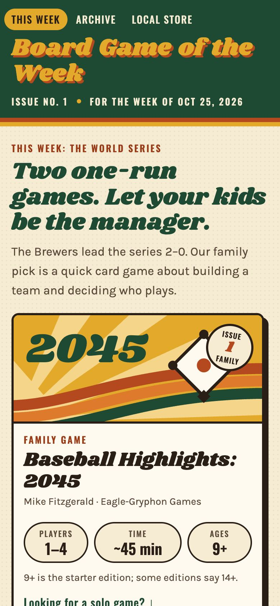
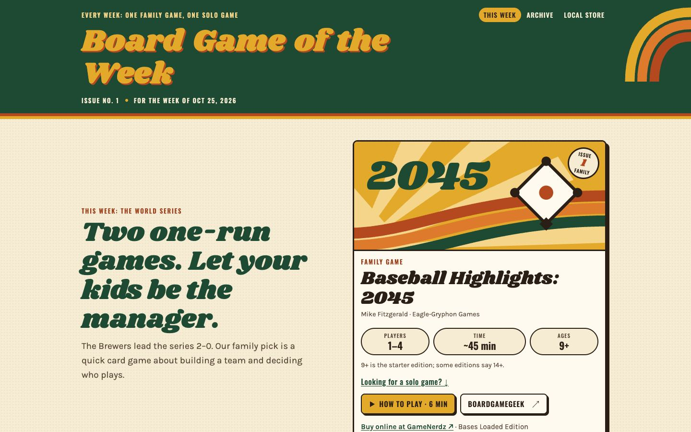
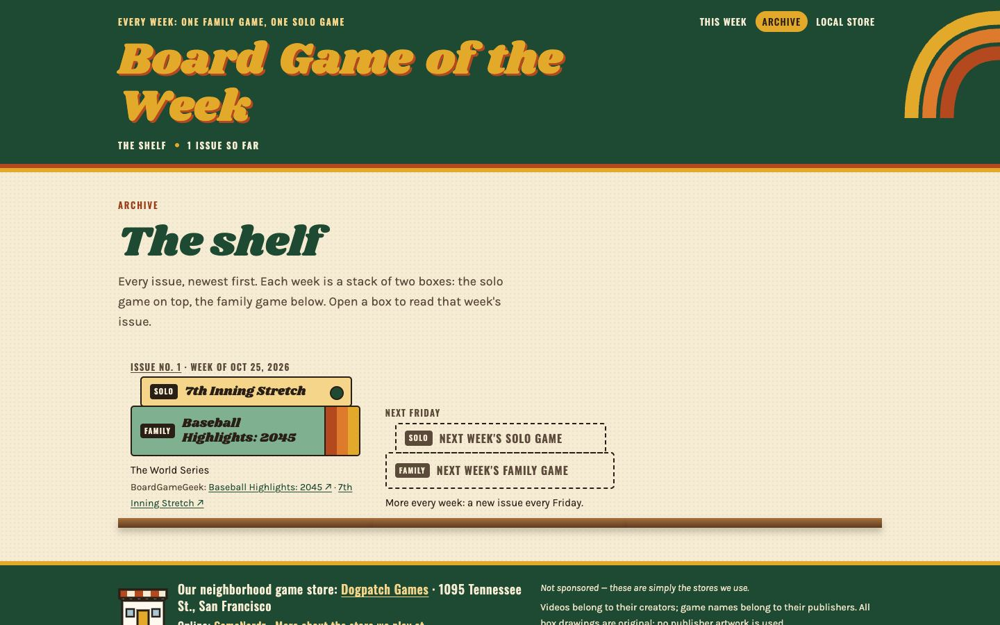
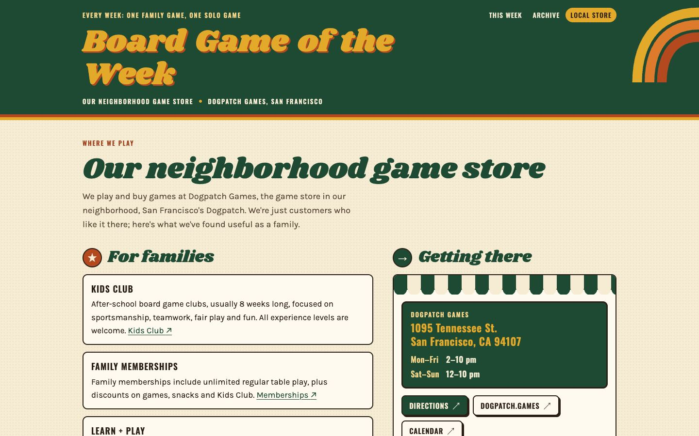

# Board Game of the Week

**One family game and one solo game, every week, picked for what's happening in the world.**

Live at **https://boardgameweek.vercel.app**

Each issue has:

- **The family game** (the main pick): players, time, ages, how to play and a BoardGameGeek link
- **Why this week**: the news that inspired it, with links to the sources
- **How to learn it**: a how-to video that loads only when you press play
- **Talk about it**: questions for younger players (about 10–12) and for teens
- **Make it work for everyone**: tips so every player can join in
- **Find a copy**: our neighborhood game store, where we buy online, and a simpler alternative
- **A solo game** for the same event (optional)

The site is fully static: no comments, accounts or feedback buttons. The only
tracking is Vercel Web Analytics.

| Phone | Desktop |
| --- | --- |
|  |  |

| The shelf (archive) | Our neighborhood game store |
| --- | --- |
|  |  |

## Pages

| URL | What |
| --- | --- |
| `/` | The newest issue (its canonical URL is the issue page) |
| `/issues/<slug>/` | Each issue, at a permanent link |
| `/archive/` | The shelf: every issue, newest first |
| `/local-store/` | Our neighborhood game store, Dogpatch Games |

## Adding a week

One week = one Markdown file in [`src/content/issues/`](src/content/issues/).
The frontmatter is checked by a zod schema in [`src/content.config.ts`](src/content.config.ts),
so a missing field or a malformed link fails the build.

```sh
npm run new-issue -- "Family Game Name"     # creates the next issue for the coming Friday (draft)
# fill in the TODOs, then set draft: false
npm i --no-save puppeteer-core@23.11.1      # once, for the share card
npm run brand -- --issues                   # writes public/og/issues/<slug>.png
npm run check && npm run build
```

The full Thursday-to-Friday routine (choosing events and games, checking facts,
picking videos and shops) is in [`docs/WEEKLY.md`](docs/WEEKLY.md).

## Run and build

Needs Node 22.23 or newer (Astro 7).

```sh
npm install
npm run dev       # http://localhost:4321 (drafts show here, not in the build)
npm run check     # astro check (TypeScript and content types)
npm run build     # static site in dist/
npm run preview
```

### Icons and share images

`scripts/brand/make.mjs` draws the favicon set (`icon.svg`, `favicon.ico`,
`favicon-32.png`, `apple-touch-icon.png`), the site share image (`public/og/site.png`)
and one 1200×630 card per issue. It drives Google Chrome through puppeteer-core,
which is not a project dependency:

```sh
npm i --no-save puppeteer-core@23.11.1
npm run brand                 # everything
npm run brand -- --issues     # only the issue cards
```

Set `CHROME_PATH` if Chrome isn't at `/Applications/Google Chrome.app/Contents/MacOS/Google Chrome`.

## Deploy

Hosted on Vercel as the project **`boardgameweek`** (framework preset: **Astro**,
build command `npm run build`, output directory `dist`). Pushing to `main` deploys.
Turn on **Web Analytics** in the Vercel project settings; the site already includes
`@vercel/analytics`.

## Built with

[Astro](https://astro.build) (static output, content collections),
the fonts [Shrikhand](https://fonts.google.com/specimen/Shrikhand),
[Oswald](https://fonts.google.com/specimen/Oswald) and
[Karla](https://fonts.google.com/specimen/Karla), self-hosted through Fontsource,
and `@vercel/analytics`.

YouTube videos use a click-to-load facade: the page shows the video's thumbnail,
and the `youtube-nocookie.com` player loads only when you press play.

## Credits

- Videos belong to their creators; each is credited where it appears.
- Game names belong to their publishers.
- All box drawings, icons and share images are original. No publisher artwork is used.
- Store details on `/local-store/` come from [dogpatch.games](https://www.dogpatch.games/).

**Not sponsored.** Dogpatch Games is the game store in our neighborhood and
GameNerdz is where we shop online. We have no ties to either; these are simply
the stores we use.

## License

Code: [MIT](LICENSE). Issue text © 2026 Nathan Nam.
